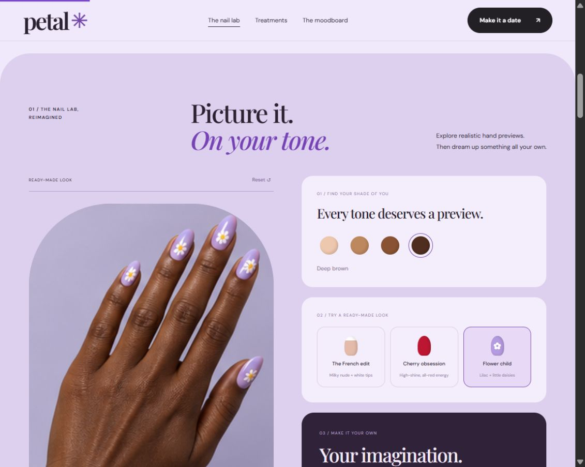
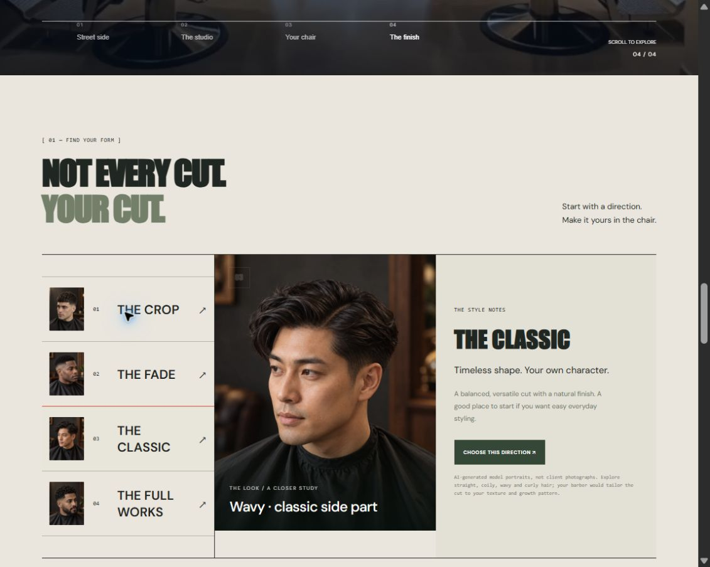

# Vanerxa

### Web development · Booking experiences · Business automation

I build responsive website experiences and explore the systems behind them—from service selection and appointments to inquiry management.

**[Visit Vanerxa](https://vanerxa.com/) · [Discuss a project](https://vanerxa.com/quote)**

## Selected website projects

### Vanerxa — digital services platform

**[Visit the website →](https://vanerxa.com/)**

- React interface components and routed service pages.
- Interactive website experiences with scroll-controlled media.
- Project work spanning Node.js/Express backend features and MySQL functionality.
- Linux hosting, SSH deployment and scripting for recurring website operations.

**Focus:** frontend web development, practical backend features and application maintenance. This is separate from the small, locally runnable API exercises below.

### Petal — nail studio concept

**[Explore the live demo →](https://vanerxa.com/examples/nails/)**

- Responsive salon design with a cinematic studio walkthrough.
- Twelve ready-made nail looks across four skin tones.
- A multi-step appointment preview with services, extras, staff, dates and times.
- A downloadable calendar entry for the sample appointment.

**Built with:** HTML, CSS and JavaScript. The portfolio source excerpt runs locally without external dependencies. Custom image generation is not part of the self-contained excerpt.

### Lineage — barber studio concept

**[Explore the live demo →](https://vanerxa.com/examples/barber/)**

- A distinct barber-shop design with a scroll-controlled walkthrough.
- Four haircut directions shown on realistic AI model portraits.
- Straight, coily, wavy and curly hair examples with style notes.
- Haircut choices carried into the appropriate sample booking service.

**Built with:** HTML, CSS and JavaScript, with responsive layouts and reduced-motion handling.

## Small API exercises

Three straightforward examples focused on HTTP, JSON and basic validation. They run together in a small local Node.js app with no external dependencies.

| Example | What it does |
| --- | --- |
| **Task API** | Add a task, list tasks, mark one complete and delete it |
| **Notes API** | Create, read, edit and delete short notes |
| **Product catalog API** | List sample products, filter by category and look up a product |

Five HTTP tests pass for these exercises. Data stays in memory and resets on restart. These are simple local demos; they do not contain real customer data or connect to production services. Implementation source is private and available for review by invitation.

## Further backend examples

These are separate, locally runnable portfolio projects. They are not connected to the public salon demos or Vanerxa's customer systems.

| Project | What it demonstrates | Technology |
| --- | --- | --- |
| **Studio booking API** | Staff availability, duration-aware overlap prevention, transactional booking, idempotent retries and administrator cancellation | Node.js 24, HTTP, SQLite |
| **Lead pipeline API** | Validated inquiries, duplicate prevention, administrator-only status updates, allowed pipeline transitions and audit history | Node.js 24, HTTP, SQLite |

**Verification:** 12 HTTP integration tests passed across the backend projects. Coverage includes conflicting appointments, retry handling, cancellation, input validation, authorization, duplicate inquiries, status history and rate limiting. Each project includes setup instructions and an API guide.

## Source access

This public profile repository contains project summaries and preview images only. **Implementation repositories stay private.** Source review can be arranged by invitation to a specific GitHub account.

The salon businesses, services, prices and appointment availability are fictional portfolio concepts. No real appointment or payment is created. Portraits and nail preview artwork are AI-generated illustrations. These projects were developed with AI assistance; they are presented as demonstration work, not client testimonials or claims of commercial results.
